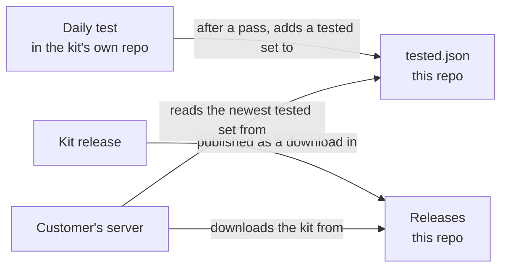

# hermes-withhuman-kit releases

In plain English: this repo holds **finished releases** of the hermes-withhuman-kit, and the **list of tested
versions**. The kit adds withHuman approvals and per-person permissions to a Hermes Agent install. Customers download
the kit from here and run it on their own servers.

Nothing here is secret. There is nothing about any customer here.

## What is here

| What | What it is |
|---|---|
| Releases | Each kit release as a download. |
| `tested.json` | Every set of versions (Hermes, the withHuman program and the withHuman image) that passed the kit's daily test together. Oldest first, newest last. Added by the daily test; nothing else changes it. Not here yet: the daily test (step 3) will add it. |

## Status

Being set up (2026-10-27). No release yet.
